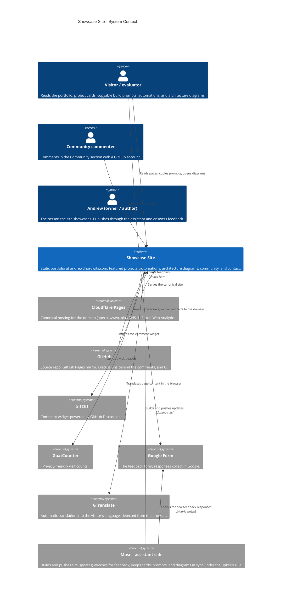
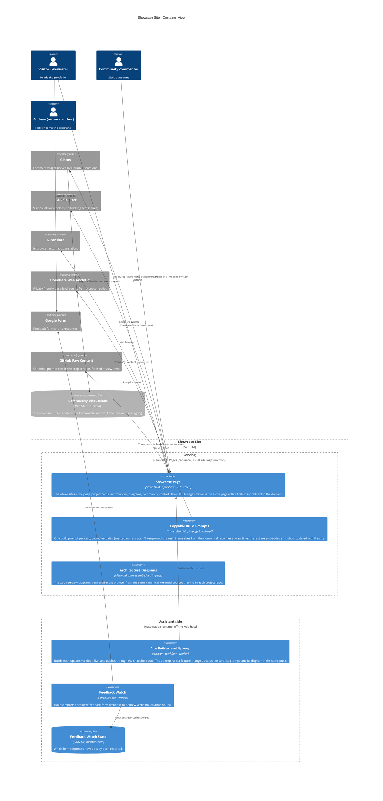

# Showcase Site — Architecture

The site as it is today: one static page (plus a privacy page) at
**andrewdhorowitz.com**, hosted on **Cloudflare Pages**, with the
GitHub Pages address kept as a mirror whose first script redirects
visitors to the domain. It carries project cards with copyable build
prompts, the v3 architecture diagrams rendered in-page, a Giscus
community section backed by GitHub Discussions, a Google Form for
feedback, GoatCounter and Cloudflare Web Analytics for counts, and
GTranslate for automatic translation. Updates are built and pushed
from the assistant side under the showcase upkeep rule. Public-safe
throughout: no private data appears here or on the site.

This file is the canonical diagram source: it renders natively on
GitHub, and the interactive page beside it is generated from the
same Mermaid source — there is no second, hand-maintained copy.

**Canonical pattern (v3, adopted Oct 28, 2026):** three views —
System Context (L1), Container (L2), and a Deployment / host view —
with shapes keyed to the kind of thing (legend under the Deployment
view) and hosts drawn as their own deployment nodes. An interactive,
draggable rendering of the Deployment view lives beside this file at
[docs/interactive-architecture.html](interactive-architecture.html):
dragging there explores the view and never changes this source.

## Level 1 — System Context

Who visits the showcase, and which outside systems it touches.

## Level 2 — Container

One static page does almost everything in the visitor's browser;
the working parts are the page itself, the prompt and diagram data
embedded in it, the third-party widgets it loads, and the two
assistant-side jobs that keep it fed.

## Deployment — Host view (v3)

Where each part actually runs: **Cloudflare Pages** serves the
canonical site, **GitHub** holds the source repo, the redirecting
mirror, the Discussions, and CI, **Muse — assistant side** runs
the upkeep and feedback jobs, and the third-party services sit in
their own node. People stand outside every host.

```mermaid
C4Deployment
    title Showcase Site - Deployment View

    Person(visitor, "Visitor / evaluator", "Reads the portfolio.")
    Person(commenter, "Community commenter", "Comments with a GitHub account.")
    Person(owner, "Andrew (owner / author)", "Publishes through the assistant.")

    Deployment_Node(cloudflare, "Cloudflare Pages", "Canonical hosting + DNS + analytics") {
        Container(page, "Showcase Page", "Static HTML / JavaScript - UI screen", "The canonical site at andrewdhorowitz.com (apex + www): cards, prompts, diagrams, community, contact.")
        Container(wa, "Web Analytics Beacon", "Cloudflare Web Analytics - server", "Page-level counts for the domain, from the beacon embedded in the page.")
    }

    Deployment_Node(github, "GitHub", "Repository hosting, Pages mirror, Discussions, Actions") {
        Container(repo, "Showcase Repo", "Git repository", "andrewdhorowitz.github.io - canonical source: the page, its prompts, the embedded diagrams, this diagram.")
        Container(mirror, "GitHub Pages Mirror", "Static HTML - UI screen", "The same page served from the github.io address; its first script redirects every visit to andrewdhorowitz.com, keeping path and query.")
        ContainerDb(discussions, "Community Discussions", "GitHub Discussions", "Comment threads for the Community section; moderation is the owner's.")
        Container(ci, "CI Workflows", "GitHub Actions - worker", "The thin fleet-CI caller (validation, links, Lighthouse) on every push.")
    }

    Deployment_Node(muse, "Muse - assistant side", "Automation runtime, off the web host") {
        Container(upkeep, "Site Builder and Upkeep", "Assistant workflow - worker", "Builds updates, verifies live, pushes via the snapshot route; keeps cards, prompts, and diagrams in sync.")
        Container(fbwatch, "Feedback Watch", "Scheduled job - worker", "Hourly check for new feedback responses; each new one is reported verbatim.")
        ContainerDb(fbstate, "Feedback Watch State", "JSON file", "Responses already reported.")
    }

    Deployment_Node(third, "Third-party services", "External widgets and counters") {
        Container_Ext(giscus, "Giscus", "Hosted widget - cloud", "Renders Discussions as the page's comment section.")
        Container_Ext(gc, "GoatCounter", "Hosted analytics - cloud", "Visit counts for the site.")
        Container_Ext(gt, "GTranslate", "Hosted widget - cloud", "Automatic translation into the visitor's language.")
    }

    Deployment_Node(google, "Google", "External services") {
        Container_Ext(gform, "Feedback Form", "Google Form - cloud", "The public feedback form linked from the site.")
        ContainerDb(responses, "Form Responses", "Google Form responses", "Where feedback lands; read by the Feedback Watch.")
    }

    Rel(visitor, page, "Visits the canonical site", "HTTPS")
    Rel(visitor, mirror, "Old links land here and redirect", "HTTPS")
    Rel(mirror, page, "Redirects to the domain")
    Rel(commenter, giscus, "Signs in with GitHub and comments")
    Rel(page, giscus, "Embeds the widget")
    Rel(giscus, discussions, "Threads live in Discussions")
    Rel(page, gc, "Visit beacon")
    Rel(page, gt, "Translation in the browser")
    Rel(page, wa, "Analytics beacon")
    Rel(visitor, gform, "Submits feedback")
    Rel(gform, responses, "Stores the response")
    Rel(fbwatch, responses, "Polls for new responses")
    Rel(fbwatch, fbstate, "Dedupes")
    Rel(upkeep, repo, "Pushes site updates")
    Rel(repo, page, "Deploys to Cloudflare Pages")
    Rel(repo, mirror, "Deploys the mirror to GitHub Pages")
    Rel(ci, repo, "Checks every push")

    UpdateLayoutConfig($c4ShapeInRow="2", $c4BoundaryInRow="1")
```

### Shape and host legend

| Visual | Means | Showcase examples |
|---|---|---|
| Person figure | A human user | Visitor / evaluator, Community commenter, Andrew |
| Browser window | A user screen / UI | Showcase Page, GitHub Pages Mirror |
| Server rack | A server / server-side function | Web Analytics Beacon |
| Gear | A worker / background or scheduled job | Site Builder and Upkeep, Feedback Watch, CI Workflows |
| Cylinder | A database / data store | Community Discussions, Form Responses, Feedback Watch State |
| Cloud | An external hosted service | Giscus, GoatCounter, GTranslate, Google Form |
| Repository | A source / code store | Showcase Repo |

Hosts: **Cloudflare Pages** (canonical site + analytics),
**GitHub** (repo, mirror, Discussions, Actions), **Muse —
assistant side** (upkeep + feedback watch), **Third-party
services** (widgets), **Google** (the feedback form).

## The three flows

**1. A visit.** The visitor reaches andrewdhorowitz.com on
Cloudflare Pages — or follows an old github.io link, where the
mirror page's first script redirects to the same path on the
domain. The page renders the cards; the copyable prompts are
embedded data (three fetch their canonical text from their repos
at view time); the architecture diagrams render in-browser from
the same Mermaid sources as the repos; GTranslate offers the page
in the visitor's language; GoatCounter and the Web Analytics
beacon each count the visit.

**2. Community and feedback.** Comments run through the Giscus
widget into GitHub Discussions — the widget is a window, the
threads live in the repo's Discussions. Feedback goes to the
linked Google Form; the assistant-side Feedback Watch polls the
responses hourly and reports each new one to Andrew verbatim.

**3. An update.** Work on the assistant side builds the change,
verifies it, and pushes it to the repo through the snapshot route;
the repo deploys to both Cloudflare Pages and the GitHub Pages
mirror, and CI checks the push. Under the upkeep rule, a feature
change carries its card text, its embedded prompt, and its
diagram in the same push — the site never describes a system its
diagrams contradict.

## Containers at a glance

| Container | Shape in diagram | Runs on | Responsibility |
|---|---|---|---|
| Showcase Page | Browser window - UI screen | Cloudflare Pages | The whole site: cards, prompts, diagrams, community, contact |
| GitHub Pages Mirror | Browser window - UI screen | GitHub Pages | Same page; redirects every visit to the domain |
| Copyable Build Prompts | Box - embedded data | In the page | One prompt per card; three self-refresh from canonical repos |
| Architecture Diagrams | Box - embedded data | In the page | v3 Mermaid sources, rendered client-side |
| Web Analytics Beacon | Server rack - server | Cloudflare | Page-level counts for the domain |
| Community Discussions | Cylinder - data store | GitHub Discussions | Comment threads behind the Giscus widget |
| CI Workflows | Gear - worker | GitHub Actions | Fleet-CI caller: validation, links, Lighthouse |
| Site Builder and Upkeep | Gear - worker | Assistant side | Builds, verifies, and pushes updates; upkeep-rule sync |
| Feedback Watch | Gear - scheduled worker | Assistant side | Hourly poll; new responses reported verbatim |
| Feedback Watch State | Cylinder - data store | Assistant side | Dedupe of reported responses |
| Giscus / GoatCounter / GTranslate | Cloud - external service | Third-party hosts | Comments widget, visit counts, translation |
| Feedback Form / Responses | Cloud + cylinder | Google | The form and where its responses land |

## Sources

Built from the showcase repo snapshot (`index.html`, `_headers`,
README) and the recorded facts of the Oct 27–29 build-out: the
Cloudflare Pages connection and verified apex + www, the
client-side mirror redirect, the Giscus Community section, the
hourly feedback watch, GoatCounter, the Web Analytics beacons
installed Oct 29, and GTranslate with browser-language detection.
