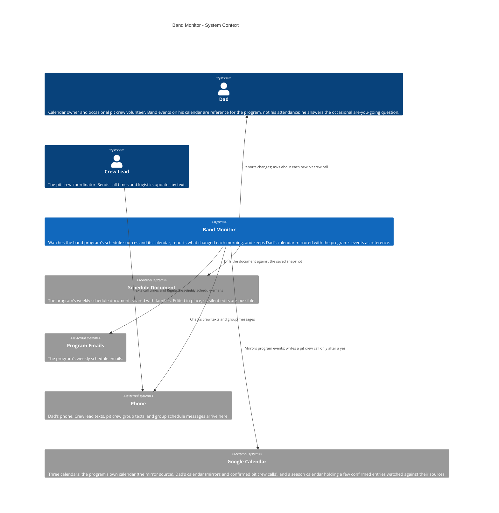
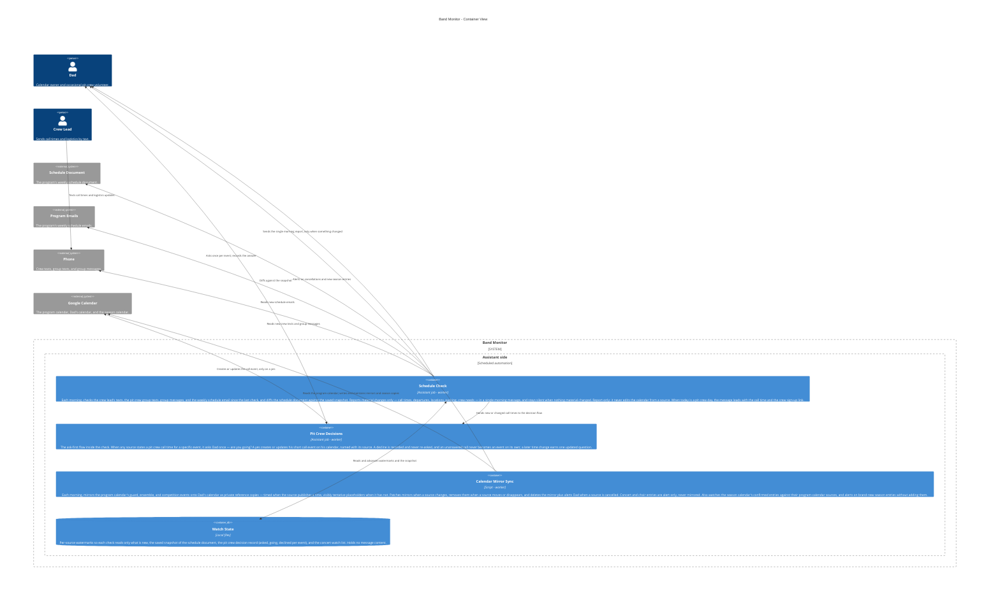

# Band Monitor — Architecture

The band monitor as it is today: every morning, two checks keep
Dad current on a school band program he volunteers for. The first
reads the program's own channels — the crew lead's texts, the pit
crew group texts, group messages, the weekly schedule emails, and
the program's weekly schedule document, diffed against yesterday's
saved copy — and reports only material changes (call times,
departures, locations, packing, crew needs), in one message, and
only when something actually changed. The second mirrors the
program's calendar onto Dad's own calendar as private reference
copies, so band days sit alongside family planning without ever
being mistaken for his attendance: he is always *possibly* on pit
crew, and possibility is not attendance. When a source states a
pit crew call time, the monitor asks Dad once — are you going? —
and only a yes puts a call event on his calendar; a decline is
remembered and never re-asked. When a source gives a start time
but no report time, the brief works from a derived be-there time;
an explicit report time always wins. On a pit crew day, the
morning message leads with the call time and the crew sign-up
link. Generic labels only: no student or crew names, no phone
numbers, no email addresses, and no document or calendar IDs.

This file is the canonical source for the Band Monitor diagram
on the showcase site: the diagrams below render on
andrewdhorowitz.com (the Band schedule monitor card, on the
Automations tab) from this same Mermaid source — never a second,
hand-maintained copy. The automation has no repo of its own, so
its canonical source lives here, in the showcase repo. Approved
by Andrew, Oct 31, 2026.

## Views included, and why

- **System Context (L1)** — the monitor, its owner, and the
  outside sources it reads. This is the primary view for a
  batch-2 automation.
- **Container (L2)** — included because real splits exist: two
  separate daily jobs (the source check and the calendar mirror
  sync), the ask-first decision flow inside the check, and the
  small local state they share.
- **Deployment / host view — omitted, deliberately.** Everything
  in this system runs in one place (the assistant side, on a
  schedule) and its only outside reads are the sources already
  shown. A deployment view would be a single boundary box
  repeating the Container view's assistant boundary, so it would
  add paper, not information. If the automation ever gains a
  second host, the view gets added then.

## System Context view

## Container view

## Containers

| Container | Shape | Technology | What it does |
|---|---|---|---|
| Schedule Check | Gear | Assistant job, scheduled | Checks texts, messages, and schedule emails; diffs the schedule document; reports material changes in one morning message, silent otherwise |
| Pit Crew Decisions | Gear | Assistant job, scheduled | Asks once per pit crew call; calendars only a yes; remembers declines and never re-asks |
| Calendar Mirror Sync | Gear | Script, scheduled | Mirrors program events onto Dad's calendar as reference copies; maintains them; alerts on cancellations and new season entries |
| Watch State | Cylinder | Local files | Source watermarks, schedule-document snapshot, pit crew decisions, concert watch list |

## Shape and host legend

| Visual | Means | Band Monitor examples |
|---|---|---|
| Person figure | A human user | Dad, Crew Lead |
| Browser window | A user screen / UI | Not used — this automation has no UI; its output is a morning message and calendar copies |
| Server rack | A server / server-side function | Not used — the automation reads hosted services and the phone instead of running a server |
| Gear | A worker / background or scheduled job | Schedule Check, Pit Crew Decisions, Calendar Mirror Sync |
| Cylinder | A database / data store | Watch State |
| Cloud | An external hosted service | Schedule Document, Program Emails, Phone, Google Calendar |
| Repository | A source / code store | Not used — no repository of its own |

Hosts: there is exactly one host boundary in these views,
**Assistant side** (the scheduled automation runtime). People and
external services stand outside it.
