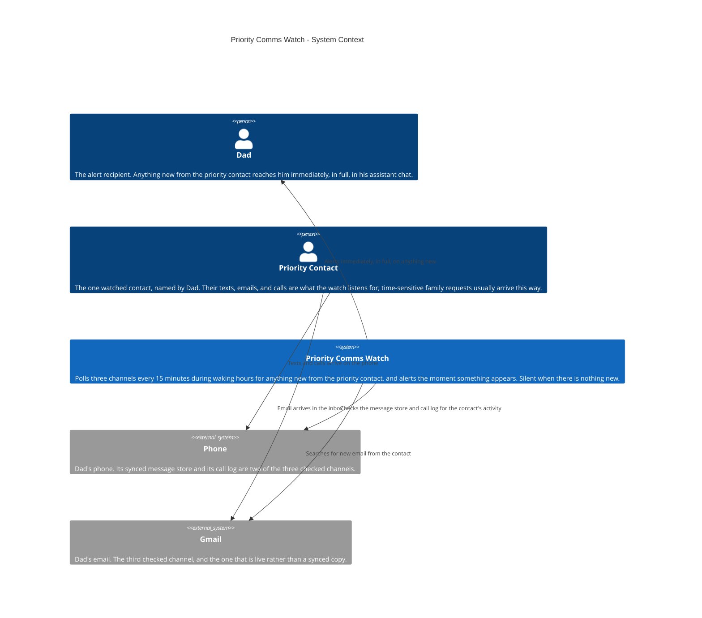
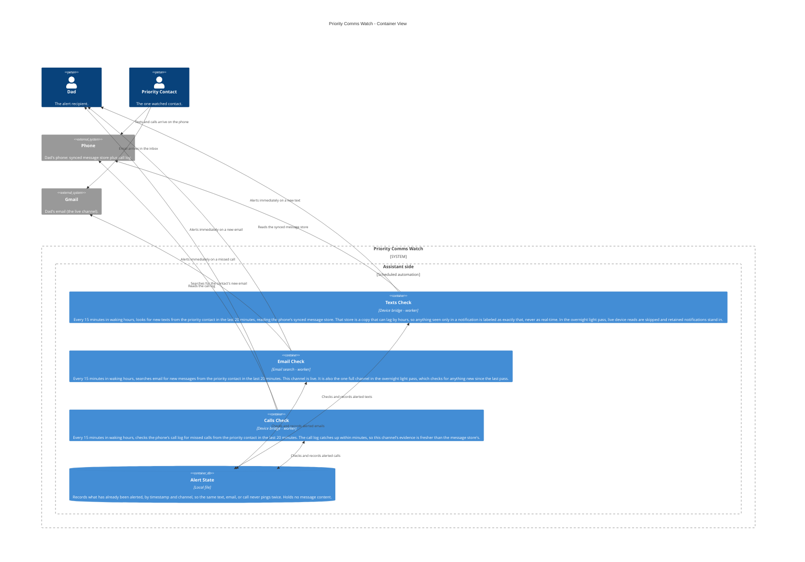

# Priority Comms Watch — Architecture

The priority comms watch as it is today: every 15 minutes during
waking hours (7 AM to 10 PM), a watch checks three channels — texts,
email, and the call log — for anything new from one priority
contact, and the moment something appears it alerts Dad in his
assistant chat, in full, so a time-sensitive family request never
sits unseen. A light overnight pass covers email and retained
notifications. The watch records what it has already alerted, by
timestamp and channel, so the same item never pings twice, and it
stays completely silent when there is nothing new. It is honest
about its evidence: the email channel is live, while the phone's
message store is a synced copy that can lag — anything seen only
in a notification is labeled as exactly that, never described as
real-time. Some alerts carry a next step: when a message confirms
or changes a pending family arrangement, it is surfaced for
action, not just noted. Public-safe, strictly: generic labels
only — no real names, no phone numbers, no email addresses, and
no message content. The watched person appears only as "Priority
Contact", exactly as the public showcase card presents the system.

This file is the canonical source for the Priority Comms Watch
diagram on the showcase site: the diagrams below render on
andrewdhorowitz.com (the Priority comms watch card, on the
Automations tab) from this same Mermaid source — never a second,
hand-maintained copy. The automation has no repo of its own, so
its canonical source lives here, in the showcase repo. Approved
by Andrew, Oct 31, 2026.

## Views included, and why

- **System Context (L1)** — the automation, its owner, the
  watched contact, and the outside services it reads. This is
  the primary view for a batch-2 automation.
- **Container (L2)** — included because a real split exists
  inside the one job: three channel checks that read different
  sources and carry different evidence quality (one channel is
  live, one source lags, one lands in between), sharing a single
  alert state that keeps the whole watch duplicate-free.
- **Deployment / host view — omitted, deliberately.** Everything
  in this system runs in one place (the assistant side, on a
  schedule) and its only outside reads are the phone and the
  email service already shown. A deployment view would be a
  single boundary box repeating the Container view's assistant
  boundary, so it would add paper, not information. If the
  automation ever gains a second host, the view gets added then.

## System Context view

## Container view

## Containers

| Container | Shape | Technology | What it does |
|---|---|---|---|
| Texts Check | Gear | Device bridge, scheduled | Reads the phone's synced message store for the contact's new texts; labels notification-only sightings as such |
| Email Check | Gear | Email search, scheduled | Searches email for the contact's new messages; the live channel, and the overnight pass's full channel |
| Calls Check | Gear | Device bridge, scheduled | Reads the phone's call log for the contact's missed calls |
| Alert State | Cylinder | Local file | Timestamp-and-channel record of what has already been alerted; the duplicate guard |

## Shape and host legend

| Visual | Means | Priority Comms Watch examples |
|---|---|---|
| Person figure | A human user | Dad, Priority Contact |
| Browser window | A user screen / UI | Not used — this automation has no UI; its output is alerts in the assistant chat |
| Server rack | A server / server-side function | Not used — the automation reads hosted services and the phone instead of running a server |
| Gear | A worker / background or scheduled job | Texts Check, Email Check, Calls Check |
| Cylinder | A database / data store | Alert State |
| Cloud | An external hosted service | Gmail, Phone |
| Repository | A source / code store | Not used — no repository of its own |

Hosts: there is exactly one host boundary in these views,
**Assistant side** (the scheduled automation runtime). People and
external services stand outside it.
