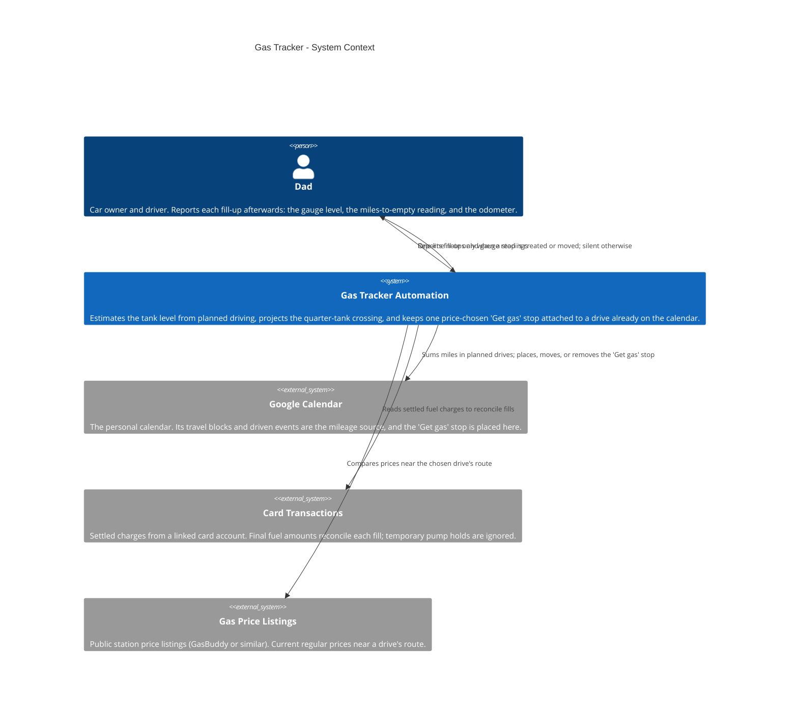
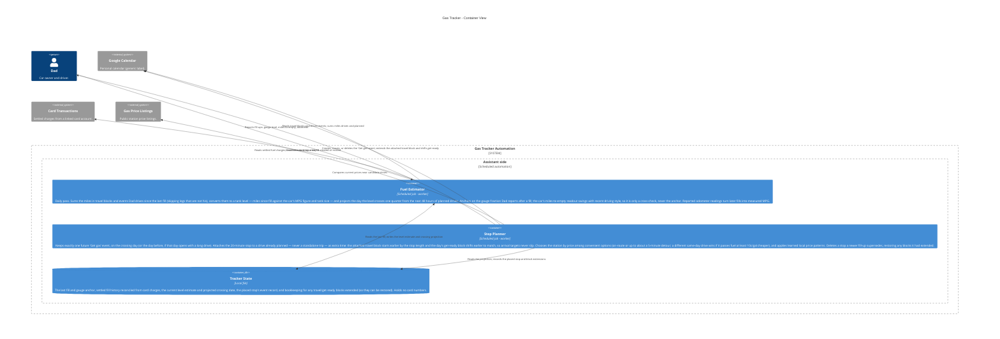

# Gas Tracker — Architecture

Every morning, an estimate pass
works out how much fuel the car has burned since its last fill-up
by adding up the miles in the calendar's planned drives, converts
that to a tank level, and projects the day the level crosses one
quarter. When the crossing is close, a single "Get gas" stop is
placed on the calendar — never as a trip of its own, always
attached to a drive already planned that day, added as extra time
so the drive's travel block starts earlier and get-ready shifts
with it, arrivals untouched. The station is chosen by price among
the convenient options on or near the route. Fill-ups Dad reports
(a gauge level, a miles-to-empty reading, an odometer reading)
reset the estimate, and settled card charges later reconcile each
fill's gallons and cost — never the pump's temporary hold.
Public-safe: generic labels only — no real addresses, station
addresses, card or account identifiers, emails, or family names
beyond what the public showcase cards already use.

This file is the canonical source for the Gas Tracker diagram
on the showcase site: the diagrams below render on
andrewdhorowitz.com (the gas tracker card, on the
Automations tab) from this same Mermaid source — never a second,
hand-maintained copy. The automation has no repo of its own, so
its canonical source lives here, in the showcase repo. Approved
by Andrew, Oct 31, 2026.

## Views included, and why

- **System Context (L1)** — the automation, its owner, and the
  outside services it depends on. This is the primary view for a
  batch-2 automation.
- **Container (L2)** — included because a real split exists inside
  the one program: the estimator that projects the tank level, the
  planner that places the single stop, and the state file they
  share.
- **Deployment / host view — omitted, deliberately.** Everything
  in this system runs in one place (the assistant side, on a
  schedule) and its only outside calls are the external services
  already shown. A deployment view would be a single boundary box
  repeating the Container view's assistant boundary, so it would
  add paper, not information. If the automation ever gains a
  second host, the view gets added then.

## System Context view

## Container view

## Containers

| Container | Shape | Technology | What it does |
|---|---|---|---|
| Fuel Estimator | Gear | Scheduled job | Sums planned miles since the last fill, converts them to a tank level, and projects the quarter-tank crossing day |
| Stop Planner | Gear | Scheduled job | Places, moves, and removes the single price-chosen "Get gas" stop, attached to an existing drive as extra time |
| Tracker State | Cylinder | Local file | Last fill and gauge anchor, settled fill history, level estimate and projection, placed-stop record and extension bookkeeping |

## Shape and host legend

| Visual | Means | Gas Tracker examples |
|---|---|---|
| Person figure | A human user | Dad |
| Browser window | A user screen / UI | Not used — this automation has no UI; its output is one calendar event |
| Server rack | A server / server-side function | Not used — the automation calls hosted services instead of running a server |
| Gear | A worker / background or scheduled job | Fuel Estimator, Stop Planner |
| Cylinder | A database / data store | Tracker State |
| Cloud | An external hosted service | Google Calendar, Card Transactions, Gas Price Listings |
| Repository | A source / code store | Not used — no repository of its own |

Hosts: there is exactly one host boundary in these views,
**Assistant side** (the scheduled automation runtime). People and
external services stand outside it.
