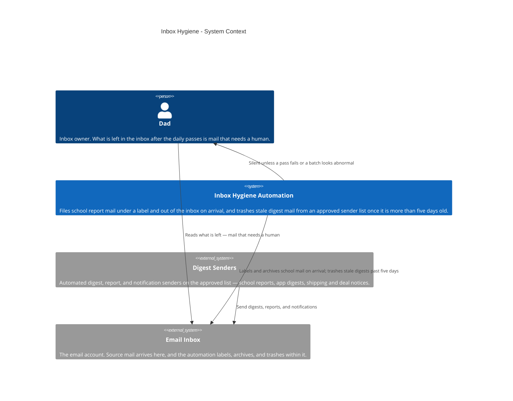
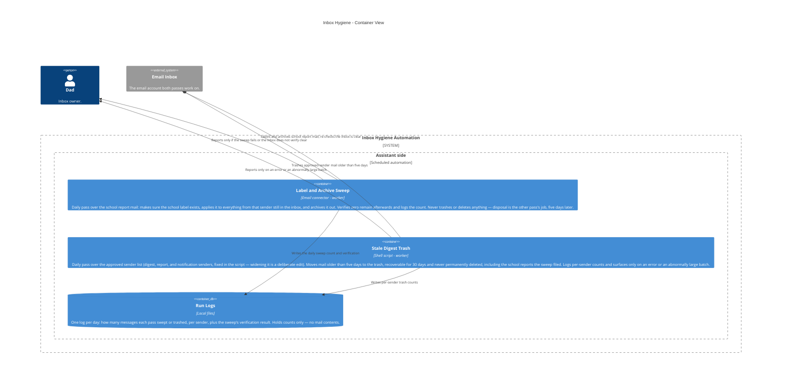

# Inbox Hygiene — Architecture

The inbox hygiene automation as it is today: every day, two
passes keep the inbox down to mail that needs a human. The first
pass files the school report mail the moment it lands — it makes
sure the label exists, applies it, and archives those messages
out of the inbox, then verifies none are left. It never deletes
anything. The second pass is the disposal step: for every sender
on an approved list of digest and notification senders, it moves
mail older than five days to the trash — recoverable for 30
days, never permanently deleted — including the school reports
the first pass filed. The sender list is fixed in the job
itself, so widening it is a deliberate edit, never a drift.
Bills and all other mail are untouched, and both passes stay
silent unless something fails or a batch looks abnormally
large. Generic labels only: no real email addresses, sender
addresses, or account identifiers.

This file is the canonical source for the Inbox Hygiene diagram
on the showcase site: the diagrams below render on
andrewdhorowitz.com (the Inbox hygiene card, on the Automations
tab) from this same Mermaid source — never a second,
hand-maintained copy. The automation has no repo of its own, so
its canonical source lives here, in the showcase repo. Approved
by Andrew, Oct 31, 2026.

## Views included, and why

- **System Context (L1)** — the automation, its owner, and the
  outside services it depends on. This is the primary view for a
  batch-2 automation.
- **Container (L2)** — included because a real split exists
  inside the system: two daily jobs with opposite safety
  postures (one files and never deletes; the other trashes, but
  only recoverably) plus the run logs they share.
- **Deployment / host view — omitted, deliberately.** Everything
  in this system runs in one place (the assistant side, on a
  schedule) and its only outside call is the email service
  already shown. A deployment view would be a single boundary
  box repeating the Container view's assistant boundary, so it
  would add paper, not information. If the automation ever
  gains a second host, the view gets added then.

## System Context view

## Container view

## Containers

| Container | Shape | Technology | What it does |
|---|---|---|---|
| Label and Archive Sweep | Gear | Email connector, scheduled | Labels school report mail and archives it out of the inbox on arrival; verifies none remain; never deletes |
| Stale Digest Trash | Gear | Shell script, scheduled | Trashes approved-sender mail older than five days — recoverable for 30 days, never permanent |
| Run Logs | Cylinder | Local files | Daily per-sender counts and the sweep verification result; holds no mail contents |

## Shape and host legend

| Visual | Means | Inbox Hygiene examples |
|---|---|---|
| Person figure | A human user | Dad |
| Browser window | A user screen / UI | Not used — this automation has no UI; its output is a tidy inbox |
| Server rack | A server / server-side function | Not used — the automation calls the email service instead of running a server |
| Gear | A worker / background or scheduled job | Label and Archive Sweep, Stale Digest Trash |
| Cylinder | A database / data store | Run Logs |
| Cloud | An external hosted service | Email Inbox, Digest Senders |
| Repository | A source / code store | Not used — no repository of its own; the sender list lives inside the trash job's script |

Hosts: there is exactly one host boundary in these views,
**Assistant side** (the scheduled automation runtime). People and
external services stand outside it.
