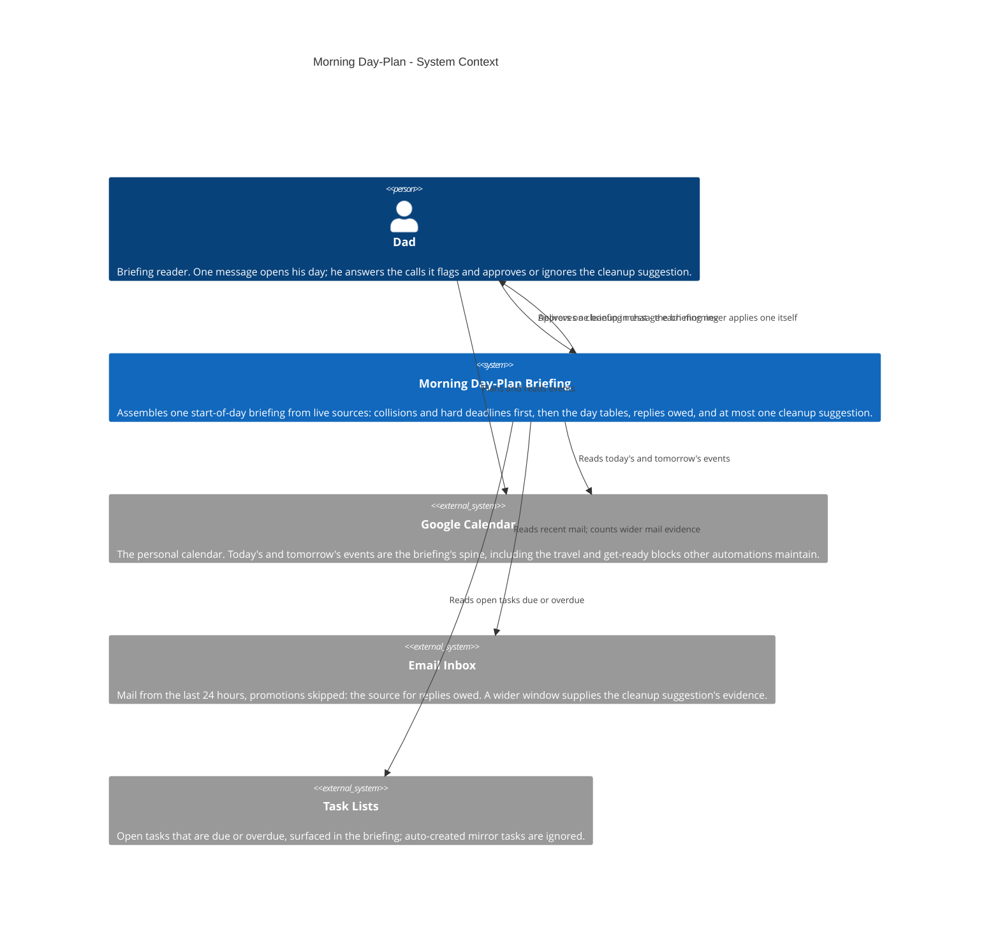
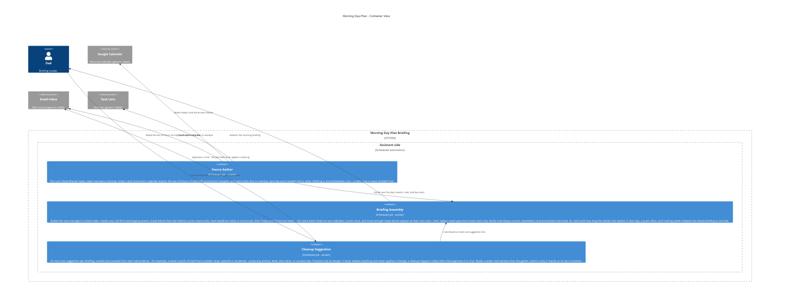

# Morning Day-Plan — Architecture

The morning day-plan briefing as it is today: every morning, a
single briefing message opens the day, assembled fresh from
live sources — never from a stored copy. It reads today's and
tomorrow's calendar events, the last 24 hours of mail
(promotions skipped), and the open tasks that are due or
overdue. The briefing leads with what needs a decision: real
collisions (overlapping events, a travel block that starts
before the previous event ends) and hard deadlines before the
next briefing. Then come the two day tables, the replies owed
to real people — each with how long they have been waiting —
and at most one inbox cleanup suggestion, counted from real
mail evidence. The job never applies a cleanup itself: it
only proposes, and a change happens solely on approval in
chat. A clear day with a quiet inbox gets exactly one line
saying so. Generic labels only: no real addresses, calendar
IDs, emails, or account identifiers.

This file is the canonical source for the Morning Day-Plan
diagram on the showcase site: the diagrams below render on
andrewdhorowitz.com (the Morning day-plan card, on the
Automations tab) from this same Mermaid source — never a
second, hand-maintained copy. The automation has no repo of
its own, so its canonical source lives here, in the showcase
repo. Approved by Andrew, Oct 31, 2026.

## Views included, and why

- **System Context (L1)** — the automation, its owner, and the
  outside services it reads. This is the primary view for a
  batch-2 automation.
- **Container (L2)** — included because a real split exists
  inside the one morning run: the gather that pulls three
  filtered source reads, the assembly that builds the
  briefing's fixed sections, and the cleanup suggestion, which
  works from a wider mail window than the gather and carries
  its own propose-only rule.
- **Deployment / host view — omitted, deliberately.** Everything
  in this system runs in one place (the assistant side, on a
  schedule) and its only outside calls are the three services
  already shown. A deployment view would be a single boundary
  box repeating the Container view's assistant boundary, so it
  would add paper, not information. If the automation ever
  gains a second host, the view gets added then.

## System Context view

## Container view

## Containers

| Container | Shape | Technology | What it does |
|---|---|---|---|
| Source Gather | Gear | Scheduled job | The three filtered live reads: two days of events, 24 hours of mail (promotions skipped), due/overdue tasks |
| Briefing Assembly | Gear | Scheduled job | Builds the briefing in fixed order — calls first, day tables, replies owed — and delivers it |
| Cleanup Suggestion | Gear | Scheduled job | Counts real mail evidence and proposes at most one cleanup; never applies one itself |

## Shape and host legend

| Visual | Means | Morning Day-Plan examples |
|---|---|---|
| Person figure | A human user | Dad |
| Browser window | A user screen / UI | Not used — this automation has no UI; its output is one chat message |
| Server rack | A server / server-side function | Not used — the automation calls hosted services instead of running a server |
| Gear | A worker / background or scheduled job | Source Gather, Briefing Assembly, Cleanup Suggestion |
| Cylinder | A database / data store | Not used — the briefing keeps no store; every run reads its sources live |
| Cloud | An external hosted service | Google Calendar, Email Inbox, Task Lists |
| Repository | A source / code store | Not used — no repository of its own |

Hosts: there is exactly one host boundary in these views,
**Assistant side** (the scheduled automation runtime). People and
external services stand outside it.
