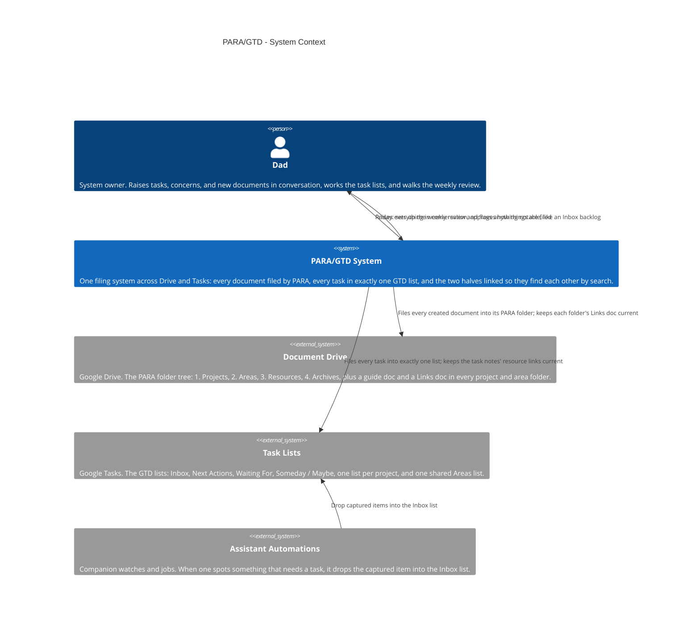
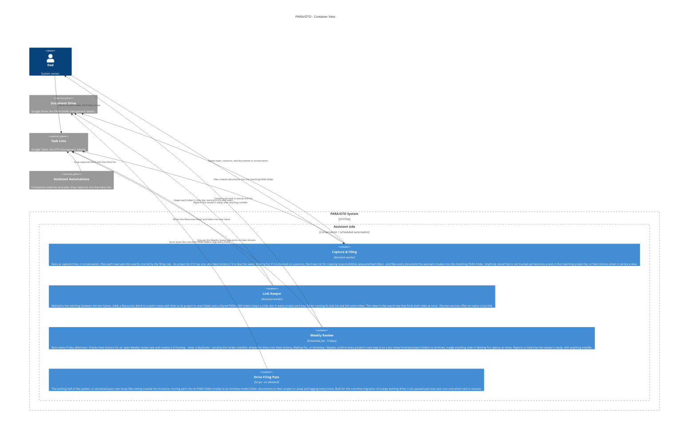

# PARA/GTD — Architecture

One filing system across two Google services. Documents live in
a Drive folder tree organized by PARA — Projects, Areas,
Resources, Archives, ordered by how actionable they are — and
every document the assistant creates is filed into its matching
folder. Tasks live in GTD lists in Google Tasks, and the filing
rule gives each task exactly one home: its project list if it
has one, else Next Actions if it is due this week, Waiting For
if it is blocked on a person, the shared Areas list for ongoing
responsibilities. The two halves are stitched together: each
task's notes carry links to its project or area folder plus a
shared token, and every folder holds a short Links doc naming
its task list and the same token, so a task and its paperwork
are always one search apart from either side. Captures arrive
in conversation and from the assistant's other automations,
which drop them into the Inbox list; a Friday job then sets up
the weekly review that walks the whole system and moves
whatever drifted back to its home.
Public-safe: generic labels only — no real folder or list IDs,
emails, or private project names beyond what the public
showcase cards already use.

This file is the canonical source for the PARA/GTD diagram
on the showcase site: the diagrams below render on
andrewdhorowitz.com (the PARA + GTD filing system card, on the
Automations tab) from this same Mermaid source — never a second,
hand-maintained copy. The automation has no repo of its own, so
its canonical source lives here, in the showcase repo. Approved
by Andrew, Oct 31, 2026.

## Views included, and why

- **System Context (L1)** — the system, its owner, and the
  services it depends on. This is the primary view for a
  batch-2 automation.
- **Container (L2)** — included because a real split exists
  inside the assistant's side of the system: the filing that
  happens at capture time, the link-keeping that stitches tasks
  to folders, the scheduled Friday review setup, and the
  backlog filing pass over the Drive.
- **Deployment / host view — omitted, deliberately.** Everything
  here runs in one place (the assistant side, in conversation and
  on a Friday schedule) and its only outside calls are the
  services already shown. A deployment view would be a single
  boundary box repeating the Container view's assistant boundary,
  so it would add paper, not information. If the system ever
  gains a second host, the view gets added then.

## System Context view

## Container view

## Containers

| Container | Shape | Technology | What it does |
|---|---|---|---|
| Capture & Filing | Gear | Assistant worker, in conversation | Files each new task into exactly one list by the filing rule, and each created document into its PARA folder |
| Link Keeper | Gear | Assistant worker | Writes the Resources block + shared token into task notes and keeps a Links doc in every project/area folder |
| Weekly Review | Gear | Scheduled job, Fridays | Ensures the self-creating Weekly review task exists on Next Actions, carrying the review checklist |
| Drive Filing Pass | Gear | Script, on demand | Sorts loose files outside the structure into their PARA folders, logging every move; paused part-way, resumes only when told |

## Shape and host legend

| Visual | Means | PARA/GTD examples |
|---|---|---|
| Person figure | A human user | Dad |
| Browser window | A user screen / UI | Not used — this system has no UI of its own; its surfaces are the Drive and Tasks apps themselves |
| Server rack | A server / server-side function | Not used — the system works through hosted services instead of running a server |
| Gear | A worker / background or scheduled job | Capture & Filing, Link Keeper, Weekly Review, Drive Filing Pass |
| Cylinder | A database / data store | Not used — the data lives in the two Google services; nothing extra is stored on the assistant side |
| Cloud | An external hosted service | Document Drive, Task Lists, Assistant Automations |
| Repository | A source / code store | Not used — no repository of its own |

Hosts: there is exactly one host boundary in these views,
**Assistant side** (conversation plus the scheduled automation
runtime). People and external services stand outside it.
