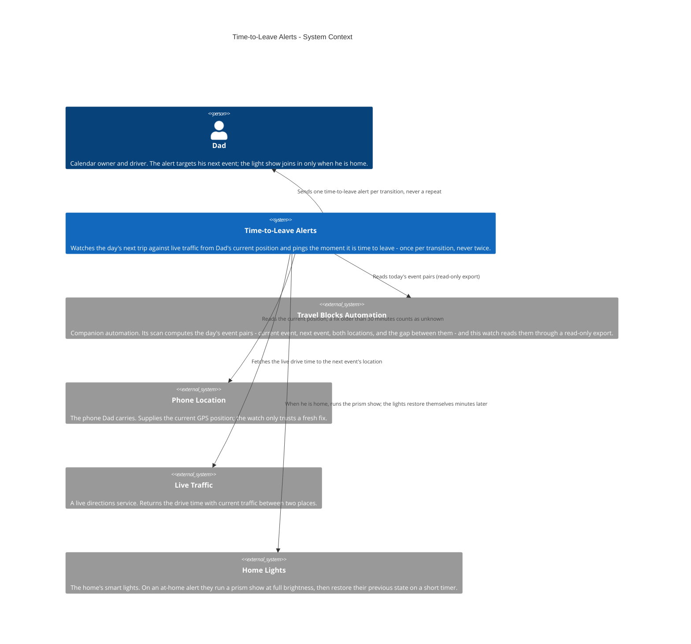
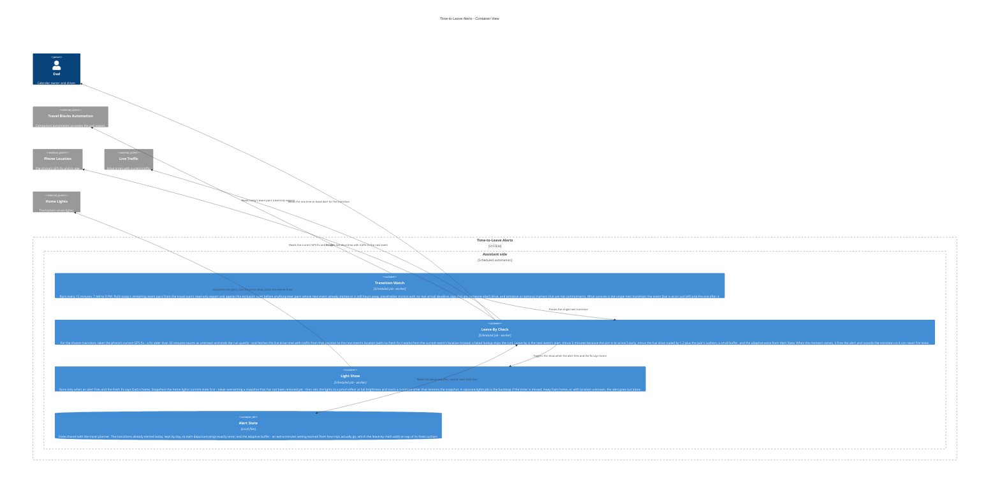

# Time-to-Leave Alerts — Architecture

Every 15 minutes between 7 AM and
9 PM, the watch works out the day's next transition — the event
Dad is at (or just left) and the next event after it — from the
event pairs the travel scan already computes, read through a
read-only export. It takes the phone's current GPS position and
fetches the live drive time with traffic to the next event's
location, then computes leave-by: the next event's start, minus
5 minutes (the aim is to arrive 5 early), minus the live drive
scaled by 1.2 plus the pair's cushion, a small buffer, and an
adaptive extra learned from how trips actually go. When the
moment comes it sends exactly one alert for that transition and
records it, so it never repeats. Pairs are filtered first:
placeholder mirrors with no real arrival deadline, tentative or
optional markers, and legs that are someone else's drive never
trigger anything. If a fresh fix says Dad is home when the alert
fires, the home lights run a prism show at full brightness —
their state snapshotted first, restored by a timer minutes
later. A GPS fix older than 30 minutes counts as unknown: the
run does nothing rather than act on stale location.
Public-safe: generic labels only — no real addresses or
coordinates, calendar IDs, emails, family names beyond what the
public showcase cards already use, or light and device IDs.

This file is the canonical source for the Time-to-Leave Alerts
diagram on the showcase site: the diagrams below render on
andrewdhorowitz.com (the time-to-leave alerts card, on the
Automations tab) from this same Mermaid source — never a
second, hand-maintained copy. The automation has no repo of its
own, so its canonical source lives here, in the showcase repo.
Approved by Andrew, Oct 31, 2026.

## Views included, and why

- **System Context (L1)** — the automation, its owner, and the
  outside services it depends on. This is the primary view for a
  batch-2 automation.
- **Container (L2)** — included because a real split exists inside
  the one repeating run: choosing the next transition, the leave-by
  math that decides whether to fire, the light show that can
  accompany an at-home alert, and the small shared state that
  keeps each alert a one-time event.
- **Deployment / host view — omitted, deliberately.** Everything
  in this system runs in one place (the assistant side, on a
  schedule) and its only outside calls are the services already
  shown. A deployment view would be a single boundary box repeating
  the Container view's assistant boundary, so it would add paper,
  not information. If the automation ever gains a second host, the
  view gets added then.

## System Context view

## Container view

## Containers

| Container | Shape | Technology | What it does |
|---|---|---|---|
| Transition Watch | Gear | Scheduled job | Reads the day's event pairs and applies the exclusion rules to pick the single next transition |
| Leave-By Check | Gear | Scheduled job | Works out leave-by from the fresh GPS fix, live traffic, and the adaptive buffer; fires and records the one alert |
| Light Show | Gear | Scheduled job | On an at-home alert, snapshots the home lights, runs the prism show, and starts the timed restore |
| Alert State | Cylinder | Local files | Already-alerted transitions by day, plus the adaptive buffer setting shared with the travel planner |

## Shape and host legend

| Visual | Means | Time-to-Leave examples |
|---|---|---|
| Person figure | A human user | Dad |
| Browser window | A user screen / UI | Not used — this automation has no UI; its output is a chat alert |
| Server rack | A server / server-side function | Not used — the automation calls hosted services instead of running a server |
| Gear | A worker / background or scheduled job | Transition Watch, Leave-By Check, Light Show |
| Cylinder | A database / data store | Alert State |
| Cloud | An external hosted service | Travel Blocks Automation (companion), Phone Location, Live Traffic, Home Lights |
| Repository | A source / code store | Not used — no repository of its own |

Hosts: there is exactly one host boundary in these views,
**Assistant side** (the scheduled automation runtime). People and
external services stand outside it.
