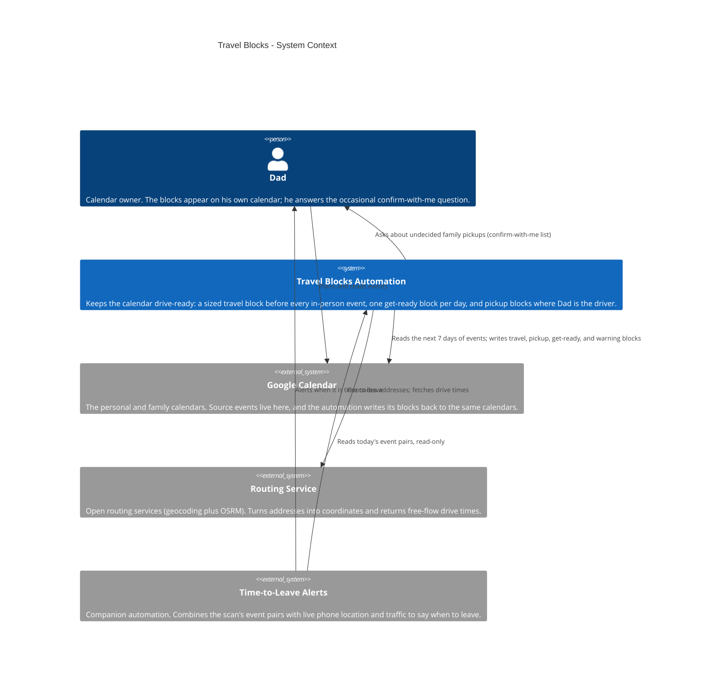
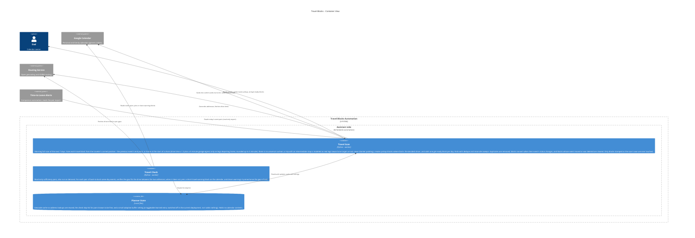

# Travel Blocks — Architecture

The self-maintaining calendar's travel-block automation as it is
today: every morning, a scan reads the next 7 days of calendar
events and keeps the calendar drive-ready. Each in-person event
with an address gets a private travel block sized from the real
drive (drive time × 1.2 plus a 5-minute garage-egress term
only on legs departing home — there is no universal cushion —
rounded up to the next 5 minutes) from the traveler's carried
position: the previous event's end point, or home at the start
of a chain. Days also get one get-ready block, and pickup
legs get a pickup block when Dad is the driver — decided by a
single precedence list, with undecided legs asked about, never
assumed. Blocks are derived state: they mirror their event's
tentative or confirmed status and are reconciled every scan, so a
moved or deleted event never leaves a stale block behind.
A trip with an intermediate stop is treated as one mission with
a single target arrival: the stops are modeled as real legs
(with a small dwell at a pickup stop), never as blanket padding
— there is no family-trip surcharge; a pickup that starts at
the other parent's home is simply the trip's first leg. An
event carries an inbound travel block, plus a return pickup
block only when Dad is the decided pickup driver and is not
staying for the event. Position carries from each event's end
point to the next trip; in a large gap, when going home in
between fits with time to spare, the next block is sized from
home as the final push and says so in its notes. A routed
drive that is implausible for the distance is refused and
reported unverified instead of being written as a giant
block.
Public-safe: generic labels only — no real addresses, calendar
IDs, emails, or family names beyond what the public showcase
cards already use.

This file is the canonical source for the Travel Blocks diagram
on the showcase site: the diagrams below render on
andrewdhorowitz.com (the self-maintaining calendar card, on the
Automations tab) from this same Mermaid source — never a second,
hand-maintained copy. The automation has no repo of its own, so
its canonical source lives here, in the showcase repo. Approved
by Andrew, Oct 31, 2026.

## Views included, and why

- **System Context (L1)** — the automation, its owner, and the
  outside services it depends on. This is the primary view for a
  batch-2 automation.
- **Container (L2)** — included because a real split exists inside
  the one program: the scan that writes blocks, the read-only
  sufficiency check, and the small local state they share.
- **Deployment / host view — omitted, deliberately.** Everything
  in this system runs in one place (the assistant side, on a
  schedule) and its only outside calls are the two external
  services already shown. A deployment view would be a single
  boundary box repeating the Container view's assistant boundary,
  so it would add paper, not information. If the automation ever
  gains a second host, the view gets added then.

## System Context view

## Container view

## Containers

| Container | Shape | Technology | What it does |
|---|---|---|---|
| Travel Scan | Gear | Python, scheduled | Creates and maintains the travel, pickup, and get-ready blocks; reconciles them against their events every run |
| Travel Check | Gear | Python, on-demand pass | Verifies back-to-back gaps fit the drive; pins and clears short-travel warnings |
| Planner State | Cylinder | Local files | Geocode cache, check skip-list, adaptive buffer setting (toggleable, currently off) |

## Shape and host legend

| Visual | Means | Travel Blocks examples |
|---|---|---|
| Person figure | A human user | Dad |
| Browser window | A user screen / UI | Not used — this automation has no UI; its output is calendar blocks |
| Server rack | A server / server-side function | Not used — the automation calls hosted services instead of running a server |
| Gear | A worker / background or scheduled job | Travel Scan, Travel Check |
| Cylinder | A database / data store | Planner State |
| Cloud | An external hosted service | Google Calendar, Routing Service |
| Repository | A source / code store | Not used — no repository of its own |

Hosts: there is exactly one host boundary in these views,
**Assistant side** (the scheduled automation runtime). People and
external services stand outside it.
