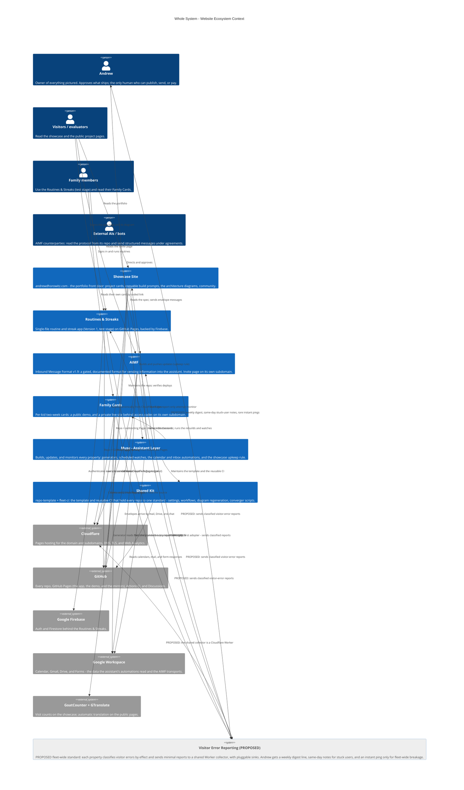

# Whole-System Context — Architecture

One picture of the whole website ecosystem as it is today: the four
properties (Showcase, Routines & Streaks, AIMF, Family Cards), the
hosts that serve them (Cloudflare Pages and GitHub Pages), the
repos behind them, the shared kit that keeps the repos to one
standard, Firebase behind the app, Google Workspace behind the
assistant's automations, and the assistant layer that builds and
maintains all of it. Per the v3 pattern this whole-system view is a
single System Context diagram; the per-project drafts carry the
three-view detail.

One element is **proposed, not built**: the fleet-wide **Visitor
Error Reporting** standard (kit proposal, repo-template issue #2).
It is named **(PROPOSED)**, shaded grey, and every one of its
relations is labelled PROPOSED. Public-safe: generic labels only —
the private Family Cards live site appears at the same abstraction
as its public demo, and no private data, addresses, or identifiers
appear here.

This file is the canonical source for the whole-system section
of the showcase site: the diagram below renders on
andrewdhorowitz.com from this same Mermaid source — never a
second, hand-maintained copy.

## System Context — the whole ecosystem

### Shape and host legend

| Visual | Means | Whole-system examples |
|---|---|---|
| Person figure | A human (or human-directed) actor | Andrew, Visitors, Family members, External AIs / bots |
| Box (system) | One of the ecosystem's own systems | Showcase, Routines & Streaks, AIMF, Family Cards, Assistant Layer, Shared Kit |
| Grey system | An external hosted service | Cloudflare, GitHub, Google Firebase, Google Workspace, GoatCounter + GTranslate |
| Grey, (PROPOSED) | A proposed system that does not exist yet | Visitor Error Reporting (PROPOSED) |

Hosts in one line each: the **Showcase** and the **AIMF invite
page** and the **live Family Cards** are canonical on Cloudflare
Pages (their GitHub Pages copies are mirrors); the **Family
Routines App** and the **Family Cards demo** are canonical on
GitHub Pages; every source lives in a **GitHub** repo held to the
**Shared Kit** standard; the **Assistant Layer** runs off the web
hosts entirely and is the only part that writes to the others.

## Reading the picture

**Two hosting lanes.** Public portfolio pieces live on GitHub
Pages subpaths, next to their code; the domain properties
(showcase apex, AIMF subdomain, private Family Cards) are served
by Cloudflare Pages — the AIMF subdomain is a deliberate,
reversible trial exception to the lane rule, recorded in its own
draft. Cloudflare also carries DNS and Web Analytics for the
domain; the github.io copies of the domain properties are mirrors
that redirect or defer to the canonical address.

**One standard.** Every repo is a thin caller of the shared kit:
the same CI, the same settings converger, the same diagram
regeneration. A fix to the kit (like the morning of Oct 29, when a
renamed repo's redirect fooled a migration script and the kit
learned to prove identity instead) propagates to the fleet by
re-running convergers, not by editing repos one at a time.

**One pair of hands.** The assistant layer is the only writer:
it generates the Family Cards from the calendars, monitors AIMF
attempts and showcase feedback, keeps every card, prompt, and
diagram in sync under the upkeep rule, and surfaces anything that
needs a decision to Andrew. Nothing in the ecosystem publishes,
sends, or changes on its own without that loop.

**The proposed layer.** Error reporting would add the ecosystem's
first shared runtime service: a small Cloudflare Worker collector
that every property reports visitor errors to, classified by
effect into tiers, behind pluggable sinks (its own store first; a
commercial error tracker later if it outgrows the homegrown log).
It is drawn here so the fleet picture stays honest about where it
would sit — touching every property, owned by the kit, read by
Andrew as one digest line in the weekly site-health report.

## Sources

Drawn from the four per-project sources: the approved Family Cards
architecture (`docs/architecture.md` in family-cards-demo) and this
project's per-project sources (Routines & Streaks, Showcase, AIMF),
plus the hosting model and status log in this goal's GOAL.md.
Family Cards is not redrawn here beyond its context-level box —
its own three views are final and live in its repo.
